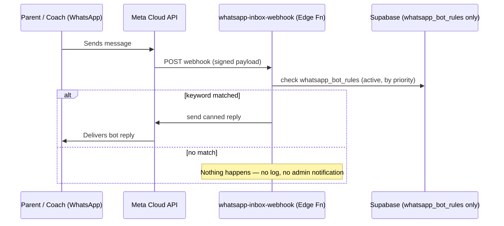

# WhatsApp Automation Bot

Keyword-triggered canned replies for incoming WhatsApp messages, configured
from the admin portal. Deliberately **stateless and storage-free** — no
message inbox, no history table, nothing about any conversation is ever
written to the database. The only thing persisted is the rules themselves.

## 1. Why this exists, and why there's no inbox

Parents and coaches message the TruCoach WhatsApp Business number directly.
For simple, common questions ("fees?", "timing?", "location?"), an admin
manually replying every time is unnecessary — a keyword match and a canned
reply covers it. This feature does exactly that and nothing more: it does
not log inbound messages, does not give admins an in-portal inbox to read
or reply from, and does not track delivery status. That's an intentional
scope decision, not a missing feature — an earlier version of this did
include a full inbox (message history table, live admin UI, manual-reply
endpoint); it was removed because the messages/history weren't wanted in
this project's database at all.

## 2. Architecture



One moving part:

| Piece | File | Runs as |
|---|---|---|
| Inbound handling + bot auto-reply | `supabase/functions/whatsapp-inbox-webhook/index.ts` | Public edge function (Meta calls it directly, no auth) |
| Bot rule management UI | `src/components/admin/WhatsAppBotDashboard.tsx` | Client — CRUD on `whatsapp_bot_rules` |

> **Naming note:** this Supabase project also has `whatsapp-webhook` and
> `send-whatsapp-message` — two functions deployed from the TruCoach mobile
> app's own backend (`/Users/vishalkhode/Desktop/TruCoach`), for automated
> template notifications like fee reminders. `whatsapp-inbox-webhook` is
> named differently on purpose (a holdover from when this feature also ran
> an inbox — see §7) so deploying it never overwrites TruCoach's function.
>
> **Confirmed: same Meta WhatsApp Business phone number for both.** That
> means this function reads the *same* Meta secrets TruCoach's functions
> already use (see §3 step 2, no duplicate secrets needed), and registering
> this webhook's URL with Meta replaces whatever callback URL is registered
> today — Meta allows only one per number.

## 3. Setup workflow (one-time, manual)

Deliberately manual, unversioned steps — Coach1 doesn't run Supabase
migrations via CLI, so the setup file says "run once in the SQL Editor" and
the edge function says "deploy with this command," on purpose, so nothing
runs against production without you explicitly doing it.

1. **Run `supabase_whatsapp_bot_setup.sql`** in Supabase Dashboard → SQL
   Editor — creates `whatsapp_bot_rules` with admin-only RLS. Nothing else.
2. **Nothing to set — reuse what's already there.** This function reads
   TruCoach's existing secrets directly (no duplicates to create):
   - `META_WHATSAPP_ACCESS_TOKEN` (already set for `send-whatsapp-message`)
   - `META_WHATSAPP_PHONE_NUMBER_ID` (already set for `send-whatsapp-message`)
   - `WHATSAPP_VERIFY_TOKEN` (already set for `whatsapp-webhook`)
   - `META_APP_SECRET` (already set for `whatsapp-webhook`)

   Just confirm all four are actually set in Supabase Dashboard → Edge
   Functions → Secrets before deploying — `META_APP_SECRET` in particular
   is required: this function hard-fails with a 500 if it's missing rather
   than accepting unsigned requests (see §6).
3. **Deploy the edge function**:
   ```
   supabase functions deploy whatsapp-inbox-webhook --no-verify-jwt
   ```
4. **Register the webhook in Meta** (App Dashboard → WhatsApp → Configuration):
   - Callback URL: `https://<project-ref>.supabase.co/functions/v1/whatsapp-inbox-webhook`
   - Verify token: must match `WHATSAPP_VERIFY_TOKEN`
   - Subscribe to the `messages` field
   - This **replaces** whatever URL is registered today (Meta allows only
     one per number).
5. **Test**: message the business number from your own phone with text
   matching an active rule's keyword — you should get the canned reply back
   within a few seconds. There's no admin-side confirmation beyond that
   (nothing is logged), so this is the only way to verify it's working.

## 4. Using the Automation Bot (admin UI)

`Automation Bot` tab in the admin portal:

- **Add Rule**: keyword(s), match type, priority, and the reply text.
- Keyword field accepts **comma-separated alternates** — e.g. `hi, hello, hey`
  matches if the message contains *any* of them (quotes around individual
  keywords are stripped automatically, so `"hi", "hello"` also works).
- Example: keyword `fees, fee, payment`, match type `contains`, reply *"Fees
  are due between the 1st and 7th of every month. Check the app under
  'Payments' for your exact batch fee."*
- Example: keyword `hi, hello, hey`, match type `exact`, priority `-10`
  (lower than the rest) — a generic greeting handler that only fires when
  nothing more specific already matched, since rules are checked
  highest-priority first.
- Toggle a rule **Inactive** to pause it without losing the wording.
- Edit or delete any rule inline.

Rules only ever fire on an inbound message — i.e. always inside Meta's 24h
free-form reply window, since the user just messaged you. No Meta-approved
template is needed for bot replies, by construction.

## 5. Why this doesn't spike Supabase usage

The bot logic runs *inside* the webhook invocation already firing per
inbound message — no new trigger, no polling, no separate cron, and (since
§7) no database write at all beyond the one `SELECT` on `whatsapp_bot_rules`
and the rate-limit RPC calls. This is about as cheap as an integration like
this can be.

## 6. Security

- **Meta signature verification is mandatory, not optional.**
  `whatsapp-inbox-webhook` validates every POST's `X-Hub-Signature-256`
  header against `META_APP_SECRET` using a constant-time comparison
  (length-check first, then an XOR accumulator — not a plain `===`, so it's
  not vulnerable to timing attacks). If `META_APP_SECRET` is ever unset, the
  function returns `500` and refuses the request outright rather than
  falling back to accepting unsigned payloads.
- **Rate limiting**, reusing TruCoach's existing `check_rate_limit` Postgres
  RPC rather than inventing something new:
  - 300 requests/min overall (DoS/flood backstop on the public endpoint,
    checked *before* signature verification so a flood can't even reach
    that work).
  - 5 auto-replies/min per phone number — stops one sender from repeatedly
    triggering a rule (by accident or on purpose) and running up paid Meta
    conversations or flooding their own number with bot replies.
- **Row Level Security on `whatsapp_bot_rules`** — verified live against the
  actual linked database (queried `pg_policies`/`pg_class` directly, not
  just read from the SQL file): `relrowsecurity = true`, and the one policy
  (`FOR ALL`) gates every operation on `role = 'admin'` in `profiles` or
  `tutors`. Anon (signed-out) requests are correctly denied — the policy
  checks `p.id = auth.uid()`, which is `NULL` for anon, so it never matches.
- **No SQL injection surface**: every query goes through the Supabase
  client's parameterized query builder (PostgREST) — nothing is built by
  string-concatenating raw SQL.
- **Bot replies can't be redirected**: the function always sends back to
  `msg.from` (the actual sender of the triggering message) — nothing in an
  inbound message's content can cause a reply to go to a different number.
- **No stored-XSS path**: `WhatsAppBotDashboard.tsx` has no
  `dangerouslySetInnerHTML`/`eval` — rule keywords and reply text render
  through normal JSX interpolation, which React auto-escapes.

## 7. History: this used to also be an inbox

An earlier version of this feature included a full admin-facing WhatsApp
inbox: a `whatsapp_messages` table logging every inbound/outbound message,
a live chat-style UI (`WhatsAppInboxDashboard.tsx`), a
`whatsapp-admin-reply` function for manual replies, unread-badge
notifications on the nav tab and Overview tile, and delivery-status
tracking. All of that was deliberately removed — the message history
wasn't wanted in this project's database at all, only the automation. If
you ever want it back, `supabase_whatsapp_remove_inbox.sql` (which dropped
`whatsapp_messages`) documents what existed; rebuilding it means recreating
that table, the two removed files/functions, and re-wiring the UI.

## 8. Known limitations / natural next steps

- Matching is plain keyword contains/exact — no typo tolerance, synonyms, or
  intent understanding. Fine for "fees", "timing", "location"; not for
  open-ended questions.
- No conversation state — every inbound message is evaluated independently;
  the bot can't hold a multi-turn exchange ("which sport?" → wait for
  reply → answer that sport's fee).
- No business-hours gate — bot rules fire 24/7 by design (that's the point),
  but if you want the bot silent during certain hours, that's a small
  addition (check current time in `whatsapp-inbox-webhook` before replying).
- No visibility at all into what the bot has sent or to whom, by design —
  if you need any record of this later, that's the inbox feature described
  in §7, not a small addition.
